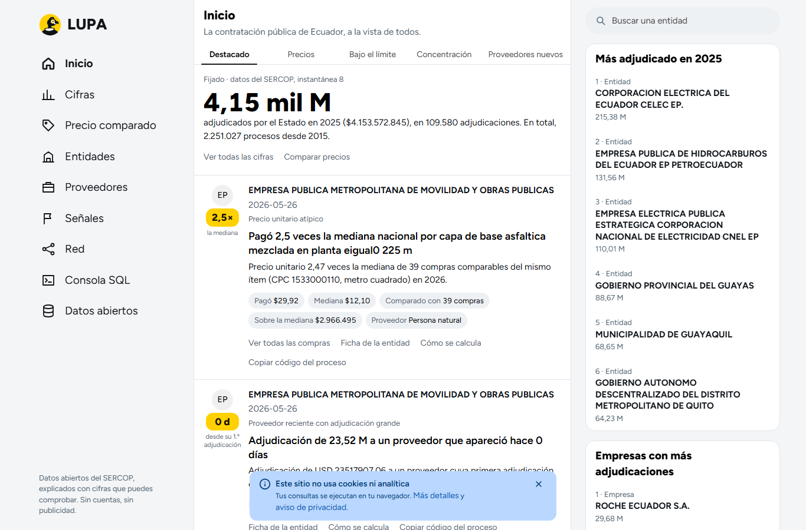
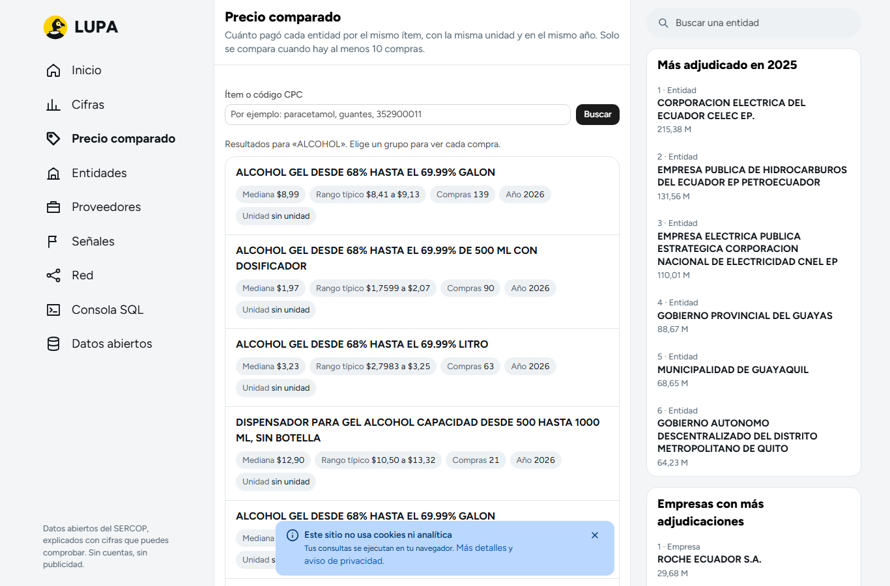
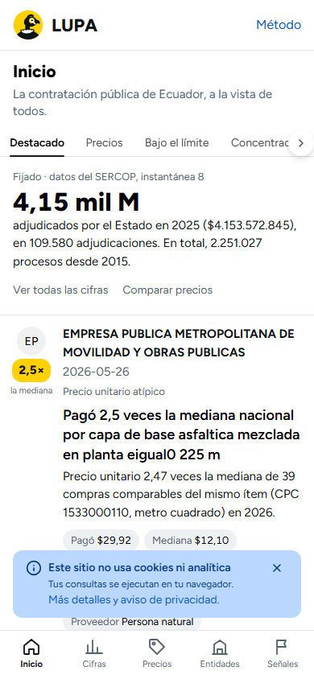
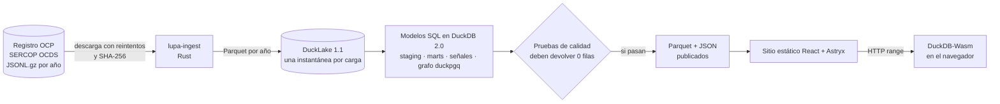
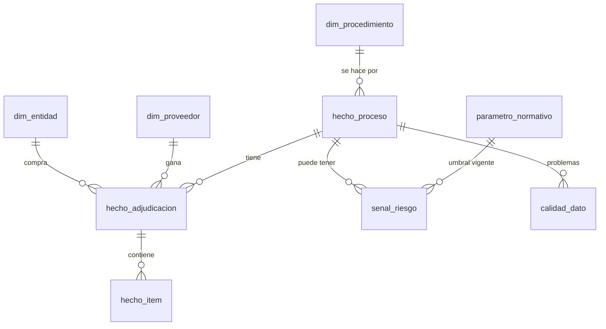

# LUPA · la contratación pública de Ecuador, a la vista de todos

Convierte 2,25 millones de procesos de compra del Estado ecuatoriano (SERCOP, 2015–2026) en respuestas que cualquiera entiende: cuánto pagó cada entidad por el mismo ítem, a quién compró y qué datos se apartan de lo habitual.

[](https://github.com/DiegoFranciscoG/lupa/actions/workflows/ci.yml)


## Demo en vivo

**https://diegofranciscog.github.io/lupa/** (se publica con el flujo «Carga semanal y publicación»). No hay usuario de prueba: el sitio es público, sin cuentas ni registro.

## Capturas

| Inicio (feed de señales) | Precio comparado | Celular |
|---|---|---|
|  |  |  |

## Problema que resuelve

En 2025 y 2026 faltaron medicinas en hospitales del MSP y del IESS y se pidieron auditorías a la Contraloría por compras públicas. Los datos de esas compras son abiertos (estándar OCDS, publicados por el SERCOP), pero vienen en archivos JSON anidados de 1 GB que casi nadie puede leer. LUPA los ordena, compara precios con estadística robusta y explica cada cifra con su fuente.

## Funcionalidades

- **Inicio tipo feed**: las señales más relevantes como publicaciones, cada una con su cifra, el dato exacto, el umbral y el método.
- **Precio comparado**: mismo ítem (CPC + unidad + año), mediana nacional, rango típico y lo que pagó cada entidad.
- **Fichas** de entidades y de empresas, con comparación contra entidades parecidas.
- **Señales**: precio atípico, concentración (HHI), compras repetidas bajo el límite legal vigente, proveedor reciente con adjudicación grande, oferta única y plazo corto (Cardinal).
- **Red de relaciones** con SQL/PGQ (estándar SQL:2023): PageRank y componentes conexos.
- **Consola SQL** en el navegador sobre todos los datos, sin servidor.
- **Datos abiertos** en Parquet, con la huella SHA-256 de cada archivo de origen.
- **RSS** por entidad y por empresa.
- Aviso legal, privacidad (LOPDP), cookies (no usa ninguna), derecho de respuesta y registro de correcciones.

## Arquitectura



No hay servidor de aplicación: la base de datos es el backend. GitHub Actions corre el pipeline cada semana y publica en GitHub Pages.

## Stack y por qué

| Capa | Tecnología | Por qué |
|---|---|---|
| Ingesta | Rust 1.99 + arrow-rs/parquet 60 | Descompresión en flujo con memoria acotada; 112 000 procesos en 5 s. Se eligió arrow-rs en vez de Polars porque toda la transformación ocurre en SQL. |
| Formato | Parquet (zstd, estadísticas por página) | Lectura columnar y por rangos HTTP. |
| Motor | DuckDB 2.0 LTS | Analítico, embebido, millones de filas en una laptop. |
| Lago | DuckLake 1.1 | Catálogo en SQL; cada carga es una instantánea consultable (`AT (VERSION => n)`). |
| Lógica | SQL (macros, modelos, pruebas) | Reglas versionadas junto a los datos que gobiernan. |
| Grafos | duckpgq (SQL/PGQ) | Grafo sobre las tablas, sin copiarlas. |
| Navegador | DuckDB-Wasm 1.32 | Consultas sin servidor; al navegador solo va Parquet (los `.duckdb` 2.0 no son legibles por 1.x). |
| Interfaz | React 19 + Astryx 0.7 (Meta) + Vite 8 | Componentes accesibles; gráficos SVG propios con tabla equivalente. |
| Señales estándar | Definiciones de Cardinal (Open Contracting Partnership) | Metodología reconocida, no inventada. |

## Modelo de datos

Detalle completo en [docs/modelo-datos.md](docs/modelo-datos.md).



## Cómo ejecutar en local

### Con Docker

```bash
cp .env.example .env    # completa LUPA_HASH_SALT con: openssl rand -hex 32
docker compose up --build
```

Descarga el año 2025 (datos de ejemplo, unos 2 minutos), construye la base, corre las pruebas y sirve el sitio en http://localhost:8080. Para todos los años: `LUPA_YEARS=2015..2026 docker compose up --build`.

### Sin Docker

Requisitos: Rust 1.99, Node 24, DuckDB CLI 2.0.0 y bash.

```bash
export LUPA_HASH_SALT=$(openssl rand -hex 32)
cargo build --release --manifest-path ingest/Cargo.toml
ingest/target/release/lupa-ingest run --years 2025
scripts/lupa.sh all
cd web && npm ci && npm run build && npx vite preview
```

## Variables de entorno

| Variable | Obligatoria | Uso |
|---|---|---|
| `LUPA_HASH_SALT` | Sí | Sal de 64 caracteres hex para enmascarar identificadores de personas naturales. Sin ella nada arranca. |
| `LUPA_YEARS` | No | Años a cargar (`2025`, `2015..2026`). |
| `LUPA_SOURCE_URL` | No | URL base del registro de OCP. |
| `DUCKDB_BIN` | No | Ruta del CLI de DuckDB 2.0. |
| `VITE_CONTACT_EMAIL` | No | Correo que muestran las páginas legales. |
| `LUPA_SITE_URL` | No | URL pública, para los enlaces de los RSS. |

## API

LUPA no tiene API REST (por eso no hay OpenAPI): los datos se publican como archivos Parquet que se consultan con SQL, desde la consola del sitio o desde DuckDB, Python o R. Ejemplos en [docs/consultas.sql](docs/consultas.sql). Tablas: `adjudicaciones`, `items`, `procesos`, `entidades`, `proveedores`, `senales`, `concentracion`, `precio_grupo`, `grafo_nodos`, `grafo_adjudico`, `grafo_compitio`, `procedimientos`.

## Tests y cobertura

| Capa | Pruebas | Comando |
|---|---|---|
| Ingesta Rust | 19 (unitarias + integración T-01, T-02, T-10); cobertura de líneas 84 % | `cargo llvm-cov` en `ingest/` |
| SQL sintético | T-03 señales esperadas, T-04 precio atípico, T-05 grafo, T-09 reproducibilidad | `scripts/lupa.sh unit` y `scripts/lupa.sh repro` |
| SQL sobre datos reales | 13 consultas que deben devolver cero filas (T-01, T-02, T-06, T-07, T-08, T-11, T-12) | `scripts/lupa.sh test` y `export` |
| Sitio | 20 unitarias (Vitest) + 12 de punta a punta (Playwright: atribución, lenguaje, peso < 300 kB, consulta < 2 s en 4G, móvil, teclado) | `npm test`, `npx playwright test` |

Las doce pruebas del plan (T-01 a T-12) están descritas en [docs/metodologia.md](docs/metodologia.md#pruebas).

## Despliegue

- **GitHub Pages** (gratis): el flujo [`publicar.yml`](.github/workflows/publicar.yml) corre cada lunes y bajo demanda, conserva el lago DuckLake en caché, salta los años cuya huella SHA-256 no cambió, corre todas las pruebas y publica solo si pasan.
- Se descartó Cloudflare Pages porque limita cada archivo a 25 MiB y los binarios de DuckDB-Wasm pesan 34 y 39 MB. No se necesita Cloudflare R2: todos los archivos de datos pesan menos de 25 MiB y caben en Pages.
- Pasos únicos: crear el secreto `LUPA_HASH_SALT`, las variables `LUPA_CONTACT_EMAIL` y `LUPA_SITE_URL`, y activar Pages con origen «GitHub Actions».

## Seguridad aplicada

Resumen en [SECURITY.md](SECURITY.md): sin servidor ni cuentas; CSP sin orígenes externos; consultas parametrizadas; secretos solo por entorno; descargas verificadas por SHA-256; acciones fijadas por hash; contenedores no root; protección de datos de personas naturales con pruebas que bloquean la publicación.

## Decisiones técnicas

- **La base de datos es el backend**: sin API que mantener ni servidor que se duerma.
- **Parquet hacia el navegador, nunca `.duckdb`**: DuckDB 2.0 escribe archivos que la versión Wasm 1.x no lee.
- **Regla de homogeneidad**: un código CPC genérico («insumos de uso general») mezcla productos; si `p75/p25 > 3` no se compara. Junto con la regla siguiente, redujo las señales de precio de 137 143 a 36 839.
- **Razones mayores a 50 veces son error de registro**: el caso real de «895 696 veces la mediana» era un precio total cargado como unitario; va a calidad de datos, no a señales.
- **Umbrales con vigencia**: la Ley de Integridad Pública cambió los límites el 26-jun-2025; los parámetros tienen fecha de inicio y fin.
- **Clasificación conservadora de personas naturales**: ante la duda, se enmascara.
- **Vista materializada para la interfaz** (`senales_top`) y agregados JSON para la primera vista: rápido en 4G.

## Roadmap

- Revisión legal de los textos antes de publicar las señales ([docs/legal.md](docs/legal.md)).
- Límites de procedimiento verificados para 2015–2024 y 2026.
- Publicar las instantáneas de DuckLake como datos descargables por versión.
- Enlace directo a cada proceso en el portal del SERCOP cuando se verifique el formato de URL.

## Fuentes de datos y licencias

- Datos: Servicio Nacional de Contratación Pública (SERCOP), vía [Open Contracting Partnership Data Registry](https://data.open-contracting.org/en/publication/110), licencia [CC BY 3.0 Ecuador](https://creativecommons.org/licenses/by/3.0/ec/). LUPA los aplana, normaliza y agrega.
- Investigación y fuentes de cada regla: [docs/investigacion.md](docs/investigacion.md).
- Código: MIT. Fuente Figtree: SIL Open Font License 1.1.

## Autor

Diego Francisco Granda Zhingre · Cuenca, Ecuador · [GitHub](https://github.com/DiegoFranciscoG) · LinkedIn: _(agregar enlace)_
