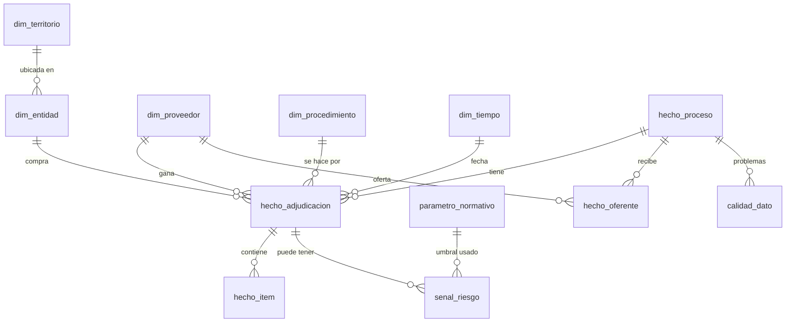

# Modelo de datos

Tres capas dentro de DuckDB 2.0 y un lago DuckLake 1.1. Los números `#n` remiten a `docs/investigacion.md`.

1. **Lago (`lake.*`, DuckLake)**: tablas crudas aplanadas por la ingesta en Rust. Cada carga es una instantánea (`snapshots()`), consultable con `AT (VERSION => n)`.
2. **Staging e intermedio (`stg_*`, `int_*`)**: vistas de limpieza y normalización.
3. **Marts (`mart.*`)**: modelo estrella publicado en Parquet.

Las migraciones son archivos SQL versionados en `sql/migrations/` (`V001__…sql`), aplicados en orden y registrados en `meta.schema_version`. No hay Flyway ni Alembic porque no hay Java ni Python: el runner de LUPA aplica cada archivo una sola vez y guarda su huella.

## Capa lago (escrita por `lupa-ingest`)

| Tabla | Grano | Campos principales |
|---|---|---|
| `lake.process` | un proceso (`ocid`) | ocid, release_id, release_date, buyer_id, buyer_name, title, procurement_method, procurement_method_details, main_category, tender_status, tender_value, tender_start, tender_end, number_of_tenderers, source_year |
| `lake.award` | una adjudicación | ocid, award_id, award_date, status, amount, currency |
| `lake.award_supplier` | proveedor de una adjudicación | ocid, award_id, supplier_id, supplier_name |
| `lake.award_item` | un ítem adjudicado | ocid, award_id, item_id, cpc_code, cpc_description, description, quantity, unit_name, unit_price, currency |
| `lake.party` | una parte | ocid, party_id, ruc, name, roles (lista), region |
| `lake.tenderer` | un oferente | ocid, tenderer_id, tenderer_name |
| `lake.load_manifest` | una carga por año | source_year, source_url, sha256, lines, awards_amount, loaded_at |

## Marts

| Tabla | Campo | Tipo | Restricción | Regla / fuente |
|---|---|---|---|---|
| `dim_entidad` | entidad_id | VARCHAR | PK, `EC-RUC-…` | #1, #4 |
| | ruc | VARCHAR(13) | 13 dígitos | #4 |
| | nombre | VARCHAR | normalizado (mayúsculas, sin dobles espacios) | |
| | tipo | VARCHAR | `publica` si tercer dígito = 6, si no `otra` | SUPUESTO-01 |
| | provincia | VARCHAR | de `parties.address.region` | #1 |
| `dim_proveedor` | proveedor_id | VARCHAR | PK | #4 |
| | ruc_publico | VARCHAR | **enmascarado** si persona natural (`17******01001` → `NAT-<hash>`) | LOPDP #18, SUPUESTO-01 |
| | nombre_publico | VARCHAR | `Persona natural` para naturales | LOPDP #18 |
| | tipo | VARCHAR | `juridica` / `natural` / `publica` | SUPUESTO-01 |
| | provincia | VARCHAR | | |
| `dim_procedimiento` | procedimiento | VARCHAR | PK, texto de `procurementMethodDetails` agrupado | #1 |
| | familia | VARCHAR | Catálogo electrónico, Subasta inversa, Ínfima cuantía, Menor cuantía, Cotización, Licitación, Régimen especial, Otro | #14, #15 |
| | descripcion_clara | VARCHAR | texto en lenguaje llano, desde `sql/seeds/procedimiento.csv` | |
| `dim_tiempo` | fecha | DATE | PK | |
| `dim_territorio` | provincia | VARCHAR | PK, 24 provincias | |
| `hecho_proceso` | ocid | VARCHAR | PK | |
| `hecho_adjudicacion` | ocid, award_id | VARCHAR | PK compuesta | #4 |
| | entidad_id, proveedor_id | VARCHAR | FK | |
| | monto | DECIMAL(18,2) | ≥ 0, USD | #1 |
| | fecha | DATE | | |
| | anio | INTEGER | 2015–2026 | #1 |
| | procedimiento | VARCHAR | FK | |
| | snapshot_id | BIGINT | instantánea DuckLake de origen | #8 |
| `hecho_item` | ocid, award_id, item_id | VARCHAR | PK | #4 |
| | cpc | VARCHAR | código CPC | |
| | unidad_norm | VARCHAR | unidad normalizada (sin tildes, minúsculas; nulo → `sin unidad`) | |
| | cantidad | DOUBLE | > 0 | |
| | precio_unitario | DECIMAL(18,4) | > 0; nulo si no viene (**no se estima**) | regla "nada inventado" |
| `hecho_oferente` | ocid, proveedor_id | VARCHAR | PK | #1 |
| `parametro_normativo` | codigo, vigente_desde | VARCHAR, DATE | PK compuesta | #14, #15, #16 |
| | vigente_hasta | DATE | nulo = vigente | |
| | valor | DECIMAL(18,2) | | |
| | fuente_url | VARCHAR | obligatorio | |
| `senal_riesgo` | ocid, indicador | VARCHAR | PK compuesta (+ item_id para precio) | |
| | valor, umbral | DOUBLE | | |
| | metodologia_version | VARCHAR | `2026.11` | |
| | explicacion | VARCHAR | frase factual sin palabras prohibidas | T-06 |
| `calidad_dato` | ocid, tipo | VARCHAR | | #1, verificacion §3 |

## Reglas de negocio (con fuente)

| Código | Regla | Fuente |
|---|---|---|
| R-LIC | Toda página y descarga lleva la atribución CC BY 3.0 EC al SERCOP y a OCP, el enlace a la licencia y la nota "datos transformados por LUPA". | #2 |
| R-NAT | Un proveedor con tercer dígito del RUC distinto de 6 y 9 es persona natural: no se publica su RUC ni su nombre en marts, rankings ni red; solo aparece como "Persona natural". | #18, SUPUESTO-01 |
| R-PRECIO | Precio atípico: mismo CPC + unidad normalizada + año; se calcula mediana y MAD; se marca si `precio > mediana + 3,5 × 1,4826 × MAD` y además `precio ≥ 2 × mediana`. Solo con ≥ 10 compras comparables. | verificacion §2 |
| R-HHI | Concentración: HHI = Σ (participación del proveedor en el gasto anual de la entidad)², escala 0–10 000; se publica con ≥ 5 adjudicaciones en el año. | metodología propia |
| R-FRAG | Fragmentación: ≥ 3 ínfimas cuantías de la misma entidad al mismo proveedor en 30 días, cada una entre 80 % y 100 % del umbral vigente en su fecha, y cuya suma supera el umbral. Solo con umbral verificado. | #14, #15 |
| R-NUEVO | Proveedor nuevo: primera adjudicación del proveedor en los datos hace menos de 90 días y monto ≥ percentil 95 del año. | metodología propia |
| R-003 / R-018 | Plazo corto (< 15 días hábiles aproximados como días corridos) y oferta única (`numberOfTenderers = 1` en procedimientos abiertos). | #5 |
| R-PALABRAS | La interfaz no puede contener "corrupción", "fraude", "robo", "sobreprecio", "culpable" fuera de la página de metodología donde se citan como prohibidas. | T-06 |

## Seeds

No hay datos personales en el repositorio. Las pruebas usan `ingest/tests/fixtures/sample.jsonl` y `sql/tests/fixtures/*.sql`, con entidades y proveedores **ficticios** (`HOSPITAL DE PRUEBA NORTE`, `PROVEEDORA DEMO S.A.`) y RUC inventados que no corresponden a nadie.
